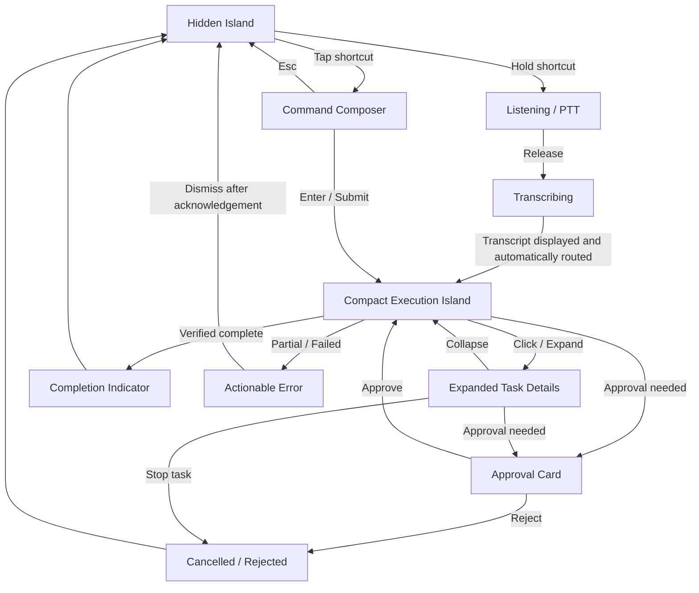
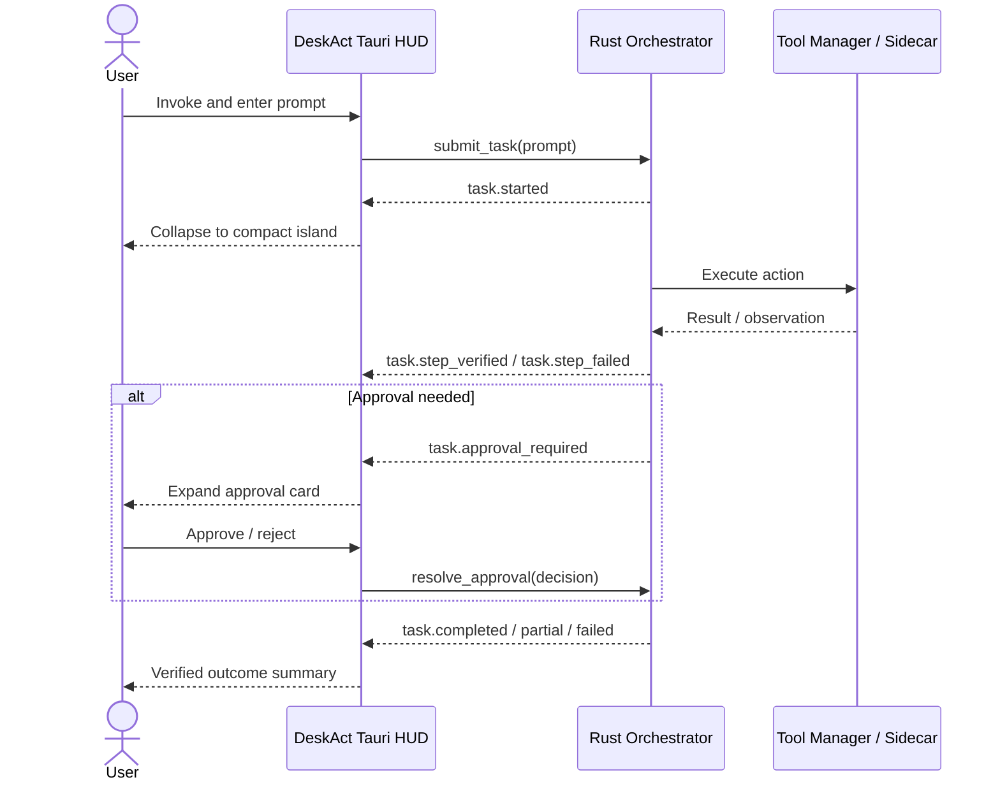

# DeskAct — Adaptive Island UI/UX Specification

- **Document type:** UI/UX specification (separate from the core product PRD)
- **Version:** 0.1 — Initial concept
- **Date:** 2026-11-05
- **Status:** Proposed design; dimensions, timings, and Windows behaviors require prototype validation
- **Related product document:** DeskAct PRD v1.13
- **Target platform:** Windows, Tauri v2 + React + Tailwind CSS

---

## 1. Overview and Design Intent

DeskAct is an AI desktop agent that executes tasks across native applications, browsers, and operating-system utilities. Its user interface should not feel like a permanent chatbot window. It should be a **compact, adaptive command surface** inspired by the contextual behavior of Dynamic Island and the keyboard-first speed of a desktop command launcher.

**Core principle:** **Hidden when idle. Minimal while working. Expanded only when interaction is required.**

This UI document describes the user-facing interaction contract, not the core orchestration design. The Rust orchestrator and its tool processes remain specified in the main PRD.

### Experience goals

- Make task invocation fast and keyboard-first.
- Keep the screen clear while DeskAct is idle.
- Show useful, human-readable feedback during execution without displaying raw agent logs by default.
- Expand automatically **only** when user intervention is required.
- Never let HUD focus changes accidentally interfere with desktop automation.
- Keep actions (approve, reject, cancel) unambiguous and accessible.
- Work as one user-facing DeskAct app, with no separate UI service.

### Non-goals for the UI MVP

- Full-screen chatbot or persistent conversation workspace.
- Always-visible desktop widget collection.
- Multiple independent floating HUD islands.
- Elaborate animations, glow effects, or live 3D graphics.
- A replacement for the agent's detailed technical logs.
- Advanced concurrent task management.

---

## 2. Design Direction

**Concept name:** Adaptive Island

**Reference interaction patterns:** Dynamic Island (compact contextual state) + Spotlight/Raycast-like command entry (fast prompt input)

**Visual treatment:** Dark graphite shell, subdued blue activity accent, green only for verified success, amber for requests needing attention, red only for errors or destructive actions. Minimal borders; quiet motion; no decorative AI imagery.

### Visual hierarchy

1. **What is happening now** — a short action/status string.
2. **What action is available** — enter, dismiss, expand, stop, approve/reject.
3. **More detail on demand** — structured steps and a link/toggle for technical logs.

### Core components

- **Island shell:** Rounded, dark, compact floating container.
- **Brand/activity marker:** Tiny DeskAct glyph or activity icon; avoid a large logo.
- **Composer:** Single focused command input, one-line initially; grows only as needed.
- **Status content:** Active action label, target app, step indicator if known.
- **Details drawer:** Expandable, step-by-step progress with safe controls.
- **Approval card:** Scope, target, risk description, explicit approval/rejection.
- **PTT indicator:** Microphone active state and simple amplitude/waveform indicator.
- **Result toast/pill:** Brief verified completion or actionable failure status.

---

## 3. Interaction States

Suggested initial bounds are **logical pixels** (DIP/CSS-equivalent at 100% scaling), not final production sizes. Adapt to Windows display scaling and text accessibility settings.

| State | Initial size target | User sees | Focus and behavior |
|---|---:|---|---|
| Hidden / Idle | No visible island | Nothing; app remains available | No focus capture; hotkey registered |
| Command Input | 480 × 110 | Prompt composer, minimal controls | Receives keyboard focus |
| Listening / PTT | 280 × 56 | Mic status, subtle waveform | Recording only during explicit hold |
| Transcribing | 280 × 56 | “Transcribing…” state | No invented transcript; clear error fallback |
| Executing / Compact | 320 × 54 | Current task step + activity indicator | Non-activating when possible; does not steal typing focus |
| Expanded Details | 480 × 220 (flexible) | Verified steps, current step, stop | User explicitly opens details |
| Awaiting Approval | 480 × 180 (flexible) | Action description, target/scope, approve/reject | Must accept deliberate user input; stays visible until resolved |
| Completed | 260 × 48 | Verified success summary | Transient status, then hide |
| Partial / Failed | 360–480 × variable | Honest outcome and next action | Do not auto-dismiss critical errors before seen |
| Cancelled | 260 × 48 | Cancellation feedback | Return to idle or hide |

**Important:** A submitted command must not be treated as completed merely because a tool command returned successfully. The UI's completion state must reflect the Rust verifier's actual task status.

---

## 4. High-Level UX Flow



### Input-to-execution behavior

1. User invokes DeskAct with the configurable global shortcut.
2. Composer opens and receives text focus, without opening a full application window.
3. The user submits with Enter; Escape closes input without running the command.
4. The composer collapses into a compact running-status island.
5. DeskAct attempts to return keyboard focus to the previously active application when safe.
6. The status island updates from structured Rust task events; it does not guess internal agent progress.
7. Verified success displays briefly before the island hides.
8. When approval or intervention is required, the island expands and remains actionable.

### PTT behavior

- Tap shortcut to open the text composer; hold shortcut past a **configurable** threshold to begin recording.
- Show a clear visual microphone-active state; never record continuously while idle.
- Release to end capture, then transcribe via the configured STT integration.
- On successful transcription, display the recognized text for transparency and automatically route it without requiring a separate submit action, consistent with PRD v1.13.
- Follow the PRD's provider-specific cloud consent, visible recording/remote-processing indicators, raw-audio discard, and PTT/cancel interruption rules.
- Provide a fallback dedicated PTT shortcut if tap/hold differentiation is unreliable or conflicts with user shortcuts.
- Escape cancels current input/recording rather than silently submitting.

---

## 5. Execution and Feedback

### Compact executing island

The default presentation should show:

- One short, user-facing status: e.g., **“Finding Liked Songs…”**
- Optional secondary line: **“Spotify · Step 2 of 3”** (only if the plan has a reliable step count).
- Activity indicator; not a fake percentage when progress is unknown.
- A visible or discoverable expand affordance.

### Expanded details

Show, as applicable:

- Task goal in one line.
- Verified completed steps (checkmarks only when actually verified).
- Current running step.
- Pending steps, if known.
- **Stop task** action, with a clear distinction between cancelling future steps and reversing actions already performed.
- Optional **Technical Log** section for developers; collapsed by default.

### Result states

- **Completed:** Desired outcome verified. Green accent, concise summary.
- **Partial:** Some steps succeeded; show remaining unverified/unfinished work.
- **Failed:** Clear error, context, and supported recovery options.
- **Cancelled:** Task stopped or rejected; avoid implying rollback.

Avoid showing raw accessibility refs, LLM chain-of-thought, shell commands, or tool JSON in the default view. An optional developer log can show safe structured diagnostics with sensitive details redacted.

---

## 6. Approval and Intervention UX

DeskAct must never auto-approve a dangerous operation on the basis of a model-generated confidence score.

Approval card requirements:

- Plain-language statement of **what** DeskAct wants to do.
- **Which application/files/account** will be affected, when determinable.
- Scope and consequence (e.g., **“Move 3 files from Downloads to Recycle Bin”**).
- Two distinct actions: **Reject** and **Approve**; no ambiguous icon-only confirmation.
- No automatic disappearance while an approval is pending.
- If the window cannot safely take focus during an automation operation, pause the automation before displaying the approval card.

Ambiguity requests (such as two similarly named Notepad windows) should use the same attention-required expansion, but offer choices rather than a misleading approval prompt.

---

## 7. Positioning, Focus, and Display Behavior

### Initial positioning

**Recommended default:** A floating island near the top center of the active monitor, approximately **12–20 logical px** below the top edge.

Alternate options:

- Attached to the top edge for a more notch-like visual.
- User-selected monitor.
- Fullscreen/game suppression or nonintrusive mode.

Do not obscure browser tabs, OS title-bar buttons, or application controls unnecessarily. The position should be adjustable after initial prototyping.

### Focus policy

| Situation | Required behavior |
|---|---|
| Open composer | Explicitly focus text input |
| Submit command | Collapse; restore previous app focus if safe |
| Passive execution | Do not steal foreground keyboard focus |
| User clicks compact island | Expand intentionally; may receive focus |
| Approval needed | Pause automation before requesting focus |
| Hide status window | Do not cancel underlying task |
| Dismiss detail panel | Keep underlying task running |

On Windows, Tauri transparent windows, always-on-top settings, click-through behavior, focus management, scaling, and multi-monitor placement must be validated on actual Windows builds. Avoid oversized transparent windows that intercept clicks outside the visible island.

### Single-task MVP rule

The initial UX supports **one active execution task**. Invoking DeskAct during an active task should surface that task and offer appropriate controls; new task submissions should be rejected or queued explicitly rather than run concurrently without user awareness.

---

## 8. UI State Events and Tauri Integration

The UI consumes structured status events from the Rust orchestrator over Tauri IPC/events. The interface is a projection of task state—not its authoritative owner.

Illustrative event vocabulary (design proposal; exact Rust types to finalize during implementation):

```text
ui.invoked
input.listening_started
input.listening_stopped
input.transcribing
input.transcription_ready
task.started
task.step_started
task.step_verified
task.step_failed
task.approval_required
task.completed
task.partial
task.failed
task.cancelled
```

### UI ↔ Core boundary



### Window handling

Start with one frameless, transparent Tauri HUD window whose *actual native bounds* are resized to content. Use a stable central anchor and controlled transitions as the island expands or collapses. If Windows focus constraints later justify a passive status window plus interactive composer window, that can be an internal implementation detail without changing the one-island user experience.

The agent's execution lifecycle must be independent of whether the HUD is currently visible.

---

## 9. Visual Design Tokens — Initial Proposal

| Token | Suggested value / usage |
|---|---|
| Island background | Dark graphite, e.g. `#191D27` |
| Primary text | Soft white, e.g. `#F0F3FA` |
| Secondary text | Cool gray, e.g. `#A4AFC1` |
| Activity accent | Muted blue, e.g. `#A2C3FF` |
| Verified success | Muted green, e.g. `#74C9A6` |
| Needs attention | Soft amber, e.g. `#EFC486` |
| Error / destructive | Reserved red, with text and icon support |
| Form | Rounded pill for status, rounded rectangle for input/approval |
| Motion | Short, subdued geometry transitions; respect reduced-motion settings |
| Effects | Minimal shadow, restrained borders; no glow-heavy decoration |

Colors and sizes must remain readable in high-contrast settings. Do not communicate status with color alone. The component dimensions must allow larger system fonts and longer localized strings.

---

## 10. Accessibility and Keyboard Interaction

- Entire composer and approval UI must be keyboard usable.
- Focus state must be visible.
- Escape closes input or cancels recording; it must not unintentionally terminate running work.
- A distinct stop/cancel-task command must be discoverable and safely implemented.
- Text and controls must remain legible at common Windows DPI scaling settings.
- Voice is optional, not required to operate DeskAct.
- If UI motion is reduced by OS settings, use minimal nonanimated transitions.
- Provide state descriptions for screen-reader users; don't rely exclusively on animated dots or waveforms.

---

## 11. MVP Implementation Sequence

**UI-0 — Prototype:** Static React/Tailwind state components, size constraints, top-center placement, focus experiments, DPI/multi-monitor checks.

**UI-1 — Text Composer:** Global hotkey invocation, submit/dismiss, previous-window focus handling, basic error display.

**UI-2 — Execution Island:** Rust task-event updates, collapse/expand, structured step list, cancel control.

**UI-3 — Attention States:** Approval, ambiguity, failure, partial-completion interfaces.

**UI-4 — PTT:** Hold-to-record, visible recording/transcribing states, transcript transparency and automatic routing, permission controls.

**UI-5 — Preferences:** Position, active monitor, shortcut customization, fullscreen behavior, reduced motion.

The UI sequence follows the orchestrator build; the command composer can be prototyped independently, but the executing-state UI must be driven by real task events before release.

---

## 12. UI Acceptance Criteria

1. **Idle:** With no active task, DeskAct occupies no persistent visible desktop area by default.
2. **Hotkey:** Invoking the shortcut opens the composer and places focus in the input field reliably on the Windows test environment.
3. **Input:** Enter submits one command; Escape dismisses without submission.
4. **Focus:** After submit, the overlay does not accidentally capture keystrokes meant for the target application.
5. **Execution:** Compact island shows real progress events; it never invents percent complete.
6. **Detail:** Expanding/collapsing details does not cancel the task or corrupt orchestrator state.
7. **Approval:** An attention-required action pauses appropriately, shows consequences, and cannot continue without an explicit decision.
8. **Failure:** Partial or failed results remain distinguishable from verified success.
9. **Cancel:** Stop prevents subsequent planned actions, while the UI explains that already-completed side effects may remain.
10. **PTT:** Microphone recording starts and stops only on deliberate input; successful transcripts are displayed and automatically routed without another submit step, consistent with PRD v1.13.
11. **Click behavior:** Transparent window regions do not prevent clicking the underlying desktop.
12. **Displays:** UI remains visible, correctly anchored, and readable at multiple common Windows scaling factors and monitor layouts.
13. **Fullscreen:** Suppression preference avoids unwanted overlays over fullscreen software.
14. **Accessibility:** Functional keyboard navigation, focus indicators, high contrast, and reduced-motion behavior.
15. **Task authority:** Hiding the island never silently terminates the active orchestration task.

---

## 13. Open UI Decisions

The following choices should be evaluated with a working Windows prototype, not prematurely fixed by visual mockups:

- Should the command composer remain attached to the top-center island or detach lower on screen for typing comfort? **Current preference: attached.**
- Should the island follow the active monitor or stay on a fixed monitor? **Current preference: follow active monitor, configurable.**
- What is the most reliable tap-vs-hold shortcut threshold across Windows keyboard layouts? **Prototype required.**
- Should passive status be click-through until the user deliberately opens it? **Prototype required; must preserve an explicit expansion path.**
- When exactly should successful completion auto-hide? **Short configurable delay, respecting accessibility.**
- How should multiple queued tasks be presented? **Defer advanced queue UI beyond MVP.**

---

## 14. Relationship to DeskAct Product PRD

This specification governs **how DeskAct looks and responds to users**. The main PRD continues to define:

- Deterministic-first intent routing with primary-LLM fallback.
- Rust orchestration and task-state authority.
- `agent-desktop`, `agent-browser`, and OS subprocess adapters.
- External OpenAI-compatible model endpoints.
- Safe retries, verification, approval policy, cancellation, and packaging.

Changes to UI states should not require changing the internal agent execution model. Likewise, changing the LLM or tool subprocess arrangement should not require redesigning the Adaptive Island interaction.
