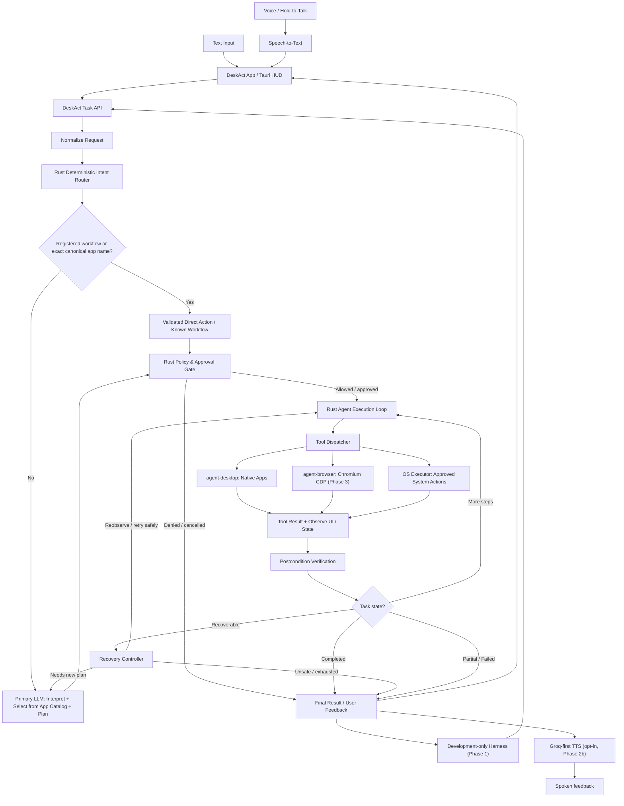
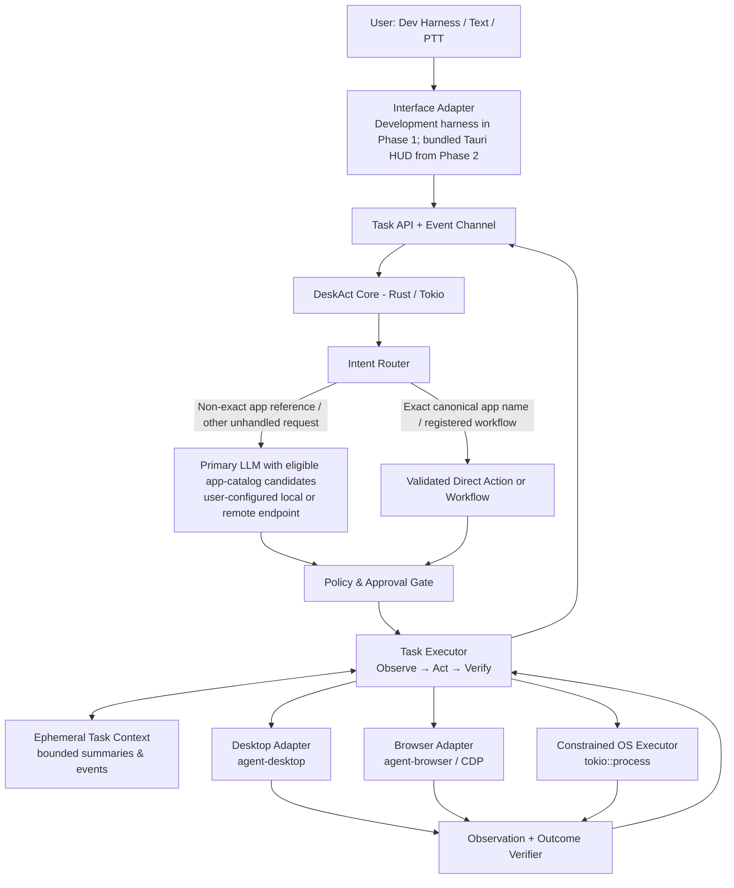
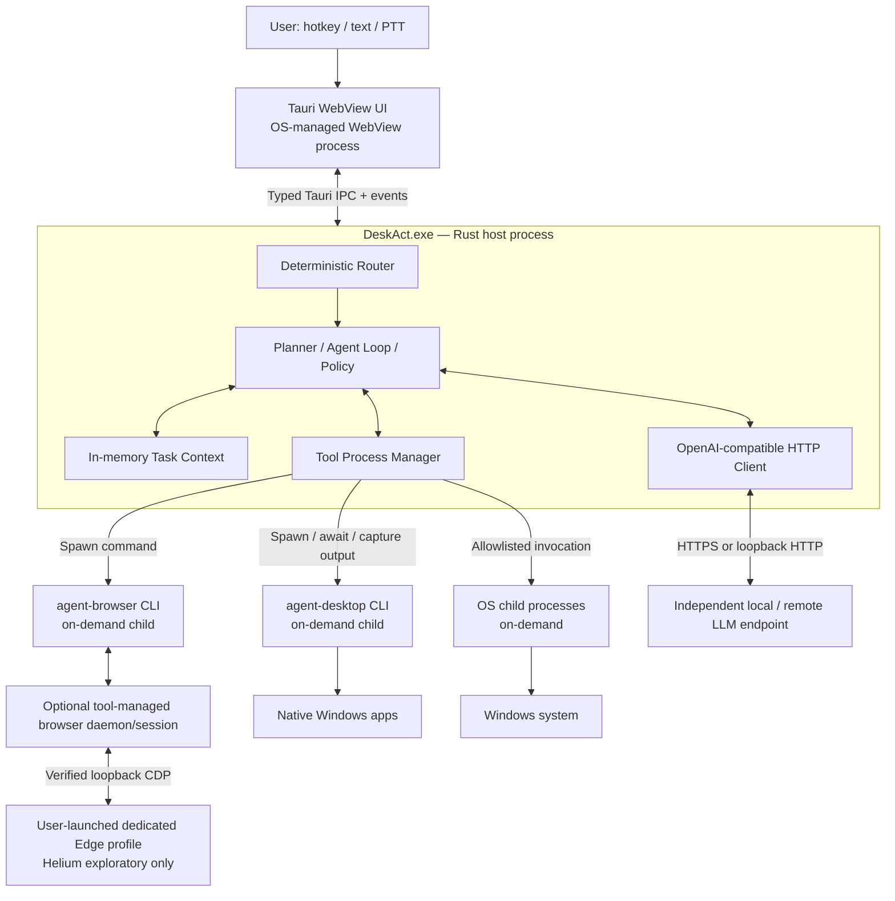
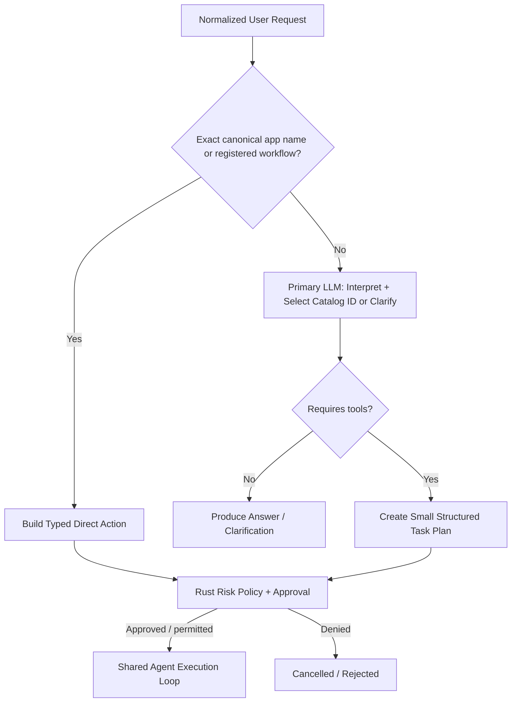
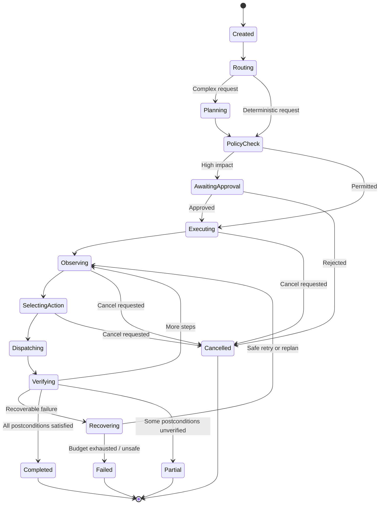
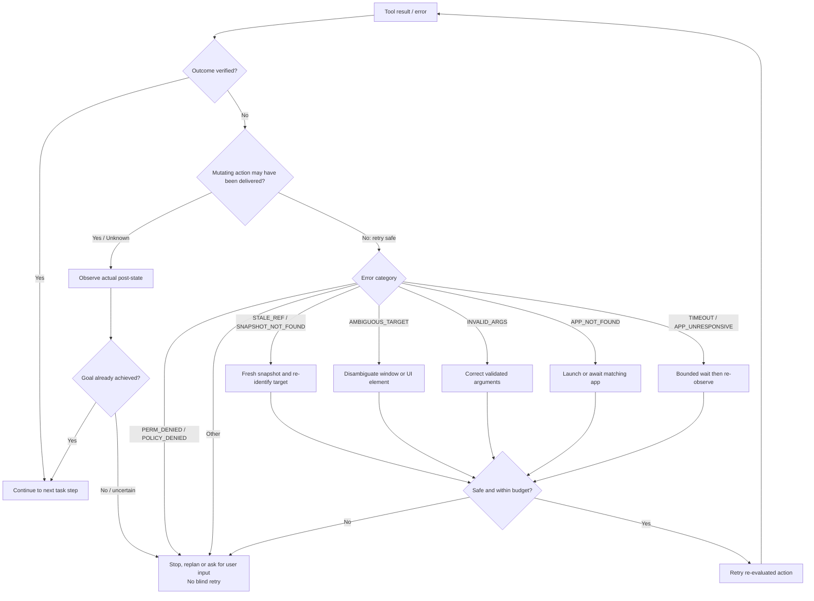
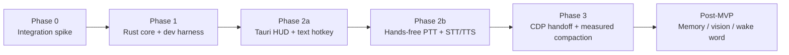

# Product Requirements Document (PRD)

## DeskAct — AI Desktop Agent for Windows

**Tagline:** Tell your computer what to do. DeskAct gets it done.

**GitHub repository (proposed):** `deskact`<br>
**Repository description:** An open-source AI desktop agent for Windows. Control native apps, browsers, and system tasks with natural language or voice. Built with Rust + Tauri.

**Version:** 1.14 — AI-assisted app selection grounded in the local catalog
**Date:** 6 November 2026
**Status:** Phase 0 closed no-go for broad native automation on the tested setup; Phase 1 authorized only under the reduced native support boundary below. Browser support boundary, LLM contract, app-selection policy, project license, and no-bundled-sidecar distribution are recorded.
**Initial platform:** Windows 10/11; other desktop platforms are out of MVP scope<br>
**Product form:** **One user-facing DeskAct application and installer.** Modular Rust orchestrator in the Tauri host process; a development-only terminal harness in Phase 1; Tauri text HUD enabled in Phase 2. Users install automation CLIs separately; DeskAct does not bundle or auto-install them.

---

## 1. Executive Summary

DeskAct is an open-source, Windows-first, accessibility-first assistant for technically comfortable power users who want to find, open, and control their PC faster. It converts natural-language instructions into *observable, controlled, and verifiable* actions across supported native applications, Chromium-based browsers, and operating-system utilities. App coverage is capability-dependent: broad support is the ambition, while reliability claims are limited to a named, tested acceptance set.

The production release is **one DeskAct desktop application** (Tauri v2 host + WebView UI). Its Rust orchestrator, router, planner, policy and tool manager are modules running in the Tauri host process, **not independent services**. A developer-only terminal harness exercises the same core in Phase 1 without shipping a separate user-facing CLI. The engine uses `agent-desktop` for native accessibility automation; `agent-browser` for Chromium automation over the Chrome DevTools Protocol (CDP); and a constrained Rust OS executor for predictable system actions. A Tauri v2 desktop HUD adds text and a hands-free push-to-talk (PTT) voice path after the core has passed terminal-harness tests; recognized speech routes automatically, with concise spoken responses and no keyboard submission on the voice happy path. `agent-desktop` and `agent-browser` are invoked as on-demand external tool processes; browser automation may reuse a tool-managed daemon/session. The LLM is **not a bundled subprocess**: DeskAct sends asynchronous API requests to a user-configured **OpenAI-compatible endpoint**, either a remote service or an independently managed local model server. **The MVP has no separate System 1/Laya router:** registered workflows and exact canonical app-name matches may be handled by deterministic Rust matching, while non-exact natural-language app selection and other unhandled intents use the single configured primary LLM. App selections are grounded in the discovered/configured catalog; the model cannot invent launch targets.

**Core principle:** DeskAct does not declare success merely because a command ran. It identifies the intended outcome, performs the action, observes the resulting state, and reports **completed**, **partially completed**, **failed**, or **cancelled** with evidence.

## 2. Problem, Goals and Non-Goals

### 2.1 Problem

Finding, opening, and controlling apps, files, folders, and common PC functions can require navigating inconsistent interfaces. Desktop automation is fragmented between OS commands, native accessibility APIs and browser tools. Natural-language requests may require multiple steps, UI structures can change between observations, and successful tool dispatch does not always mean the user’s goal was achieved. Naive retries may also duplicate sensitive actions.

### 2.2 MVP goals

1. Help power users find, open, and control Windows apps, files, folders, and common system functions through natural language.
2. Execute registered multi-step workflows and unique exact canonical app-name matches without a model when their inputs are fully specified; use the primary LLM to resolve non-exact natural-language app requests against the local catalog and for other unrecognized or dynamic tasks.
3. Control supported native applications through an accessibility-first observe → act → verify loop; treat broad app compatibility as capability-dependent, not guaranteed.
4. Include best-effort browser automation, with native applications as the reliability baseline.
5. Recover from stale UI references and bounded transient failures without choosing the wrong target or duplicating actions.
6. Provide transparent progress, cancellation, verification and meaningful failure explanations through a developer-only terminal harness in Phase 1 and the Tauri HUD from Phase 2.
7. Provide hands-free PTT input that automatically routes recognized English speech and concise spoken feedback, while retaining the same safety and approval policy as typed requests.
8. Ship one DeskAct application/installer with modular in-process Rust code, supervised on-demand tool invocations and dynamic, vendor-neutral OpenAI-compatible endpoints.

### 2.3 Explicit non-goals

- Guaranteed control of arbitrary applications or controls, including apps that do not expose usable accessibility information.
- A claim that every accessible app or workflow has equal reliability; only the named acceptance corpus has measured reliability targets.
- Continuous microphone listening or wake-word detection.
- Screenshot/vision-driven automation, game automation or guaranteed control of inaccessible canvases.
- Persistent semantic/episodic/procedural memory or automatic learning from user behavior.
- Unrestricted natural-language execution of arbitrary shell commands.
- Fully autonomous sending, purchasing, deleting, installing or credential-handling without an appropriate user approval gate.
- Mac/Linux support in the initial acceptance suite.
- **A separate System 1 classifier, Laya, secondary routing LLM, or learned decision engine.** These are not required for the MVP and may only be reconsidered after benchmarking.

## 3. Product Principles

- **Accessibility before pixels.** Prefer semantic UI elements and validated references; physical pointer input is exceptional, not the default.
- **Grounded AI, not alias training.** The primary LLM interprets non-exact app references against the current discovered/configured catalog. Exact canonical app names and registered workflows may use deterministic fast paths. The model proposes a catalog entry, never an executable path or permission; Rust validates it. User aliases are optional and explicit, not required or learned.
- **Observe, act, verify.** Separate tool delivery evidence from application-level outcome verification.
- **Safe retries only.** Inspect whether an action could already have been delivered before repeating it.
- **Bounded context.** Store operational facts in Rust; pass only necessary observations and a compact task summary to the model.
- **Least privilege.** Permit only defined tool actions, protect secrets and require action-specific confirmation for consequential changes; stop on material uncertainty.
- **Inspectable behavior.** Emit structured events and clear status to make failures reproducible.
- **One app, not many services.** Keep Rust orchestration, planning, routing, task state and tool management in the DeskAct host process; spawn automation tools only when needed.
- **Configurable LLM connection.** Use a dynamic OpenAI-compatible URL/model/key configuration, not a hard-coded provider or separate router model.
- **Audited redistribution.** Bundling third-party tools is subject to documented license notices, transitive-dependency and runtime checks.

## 4. High-Level Operational Flow (User Request → Verified Result)

This is the product's **runtime data path**. It describes what happens after a user speaks or types, not just which modules exist. The same Rust task API is exercised by the Phase 1 development harness and later by the bundled Tauri HUD.



**Interpretation:** Voice is transcribed to text before routing; the development-only harness bypasses the HUD while testing the same Rust core. **There is no second AI router.** Registered workflows and unique exact canonical app-name matches can use local deterministic paths. For non-exact app language, the *primary* LLM interprets the request against the eligible discovered/configured app catalog and may select a catalog entry or ask for clarification; it cannot invent an app target. Other unmatched requests may also go to the primary LLM. The Rust policy gate controls all action requests. The Rust loop reobserves and verifies each meaningful step; it calls the primary LLM again only when replanning is genuinely necessary. The output is a verified outcome or a transparent partial, failed, or cancelled status.

### 4.1 Input-to-execution examples

| Request | Route | Expected execution |
|---|---|---|
| “Open Calculator” | Unique exact canonical app-name match (or registered workflow) | OS executor → launch directly → wait for target window → verify |
| “Open the app I use for music” | Primary LLM selects from discovered/configured app candidates | Validate catalog ID → launch configured target → wait for target window → verify |
| “Open Downloads” | Known folder alias | Validated OS action → verify location opened |
| “Open my editor” (multiple plausible catalog entries) | Primary LLM requests clarification using catalog candidates | Show candidates and ask; never choose randomly; optional explicit aliases are convenience only |
| “Open Notepad and insert this exact text” | Registered workflow if supported, otherwise LLM plan | OS + `agent-desktop` → verify content |
| “Open VLC and play the sample video” | Main LLM unless a tested workflow is registered | `agent-desktop` observe/act/verify loop; verify playback state where observable |
| “Summarize what this document says” | Main LLM | Read approved content → respond; no desktop mutation required |
| “Delete all files in Downloads” | Policy gate regardless of routing | Explicit approval and constrained scope; never execute arbitrary shell text |

### 4.2 Routing invariant

The deterministic router does **not** try to infer whether a request is “simple” or “complex” using a heuristic confidence threshold. It handles registered workflows and unique exact canonical app-name matches; otherwise the primary LLM may resolve natural-language app intent against the current catalog or plan an unhandled task. The model must return a supplied catalog ID or request clarification; Rust rejects unknown IDs and never accepts model-provided executable paths or shell commands. Multi-step does not automatically mean LLM-required, and short phrasing does not automatically mean safe.

## 5. User Experience and Representative Journeys

### 5.1 Journey A — app selection and deterministic launch

**Instruction:** “Open Calculator.”<br>
A unique exact canonical app-name match can resolve locally. For non-exact wording, the primary LLM selects from the discovered/configured catalog, or asks the user when multiple apps plausibly match. Rust validates the catalog ID and target, launches directly, waits for a uniquely matched window, and verifies it; the model never supplies the executable path.

### 5.2 Journey B — native multi-step task

**Instruction:** “Open Notepad, type a short note, and save it to my Desktop.”<br>
DeskAct builds a minimal plan, opens the app, observes the target window, selects the relevant editor, types, and verifies the text where observable. Before saving, it follows the applicable overwrite approval policy; afterward it verifies both the intended path and expected content (not merely that a file exists). If evidence is unavailable or ambiguous, it reports the precise uncertainty rather than inventing success.

### 5.3 Journey C — native application with dynamic UI

**Instruction:** “Open VLC and play the sample video.”<br>
DeskAct launches or restores VLC, identifies the intended local test file and playback control, then checks for playback-state evidence. If the application exposes insufficient evidence, DeskAct reports *delivered but unverified* or *partially completed* rather than claiming playback started.

### 5.4 Journey D — browser handoff (best-effort)

**Instruction:** “Open my dashboard tab and find the latest report.”<br>
DeskAct confirms an authorized local CDP connection, identifies the correct browser tab, uses `agent-browser` for the web UI, and verifies the navigation/result where observable. Browser automation is best-effort and is not held to the native-app reliability target. It does not assume an existing browser profile is automatically attachable.

### 5.5 Journey E — hands-free voice task

**Instruction:** The user holds the PTT shortcut, says “Open Calculator,” then releases it. DeskAct transcribes English speech, shows the transcript for transparency, and automatically routes the request without keyboard submission. It speaks a concise result. If a consequential action needs approval, DeskAct states the exact action and accepts only a clear “approve” spoken through PTT; the microphone is not otherwise listening.

## 6. System Architecture



### 6.1 Core subsystems

| Component | Responsibility |
|---|---|
| In-process Rust core | Task lifecycle, orchestration, step selection, state transitions, deadlines and cancellation inside the Tauri host process |
| Intent Router | Deterministic registered-workflow and exact canonical-name fast paths; delegates non-exact app selection to the primary LLM with catalog candidates; no separate learned classifier |
| LLM Connector / Planner | One configurable OpenAI-compatible API endpoint, model and credentials; supports remote providers or a separately managed local model server; never launches local LLM itself |
| Policy Engine | Tool allowlists, risk classification, approval gates and audit decisions |
| Tool Manager / Dispatcher | Routes typed actions, starts bounded subprocesses on demand, manages deadlines/cancellation, checks exit codes/output, reuses sessions as supported, and cleans up only DeskAct-owned children |
| Desktop Adapter | Structured `agent-desktop` CLI invocation, schema checks, session scoping and UI refs |
| Browser Adapter | CDP connection, tab identity, browser snapshots and actions (Phase 3) |
| OS Executor | Explicit executable/argument invocation and constrained file/system operations |
| Verifier | Evaluates postconditions; separates delivery status from the requested outcome |
| Recovery Controller | Uses error type, action idempotency and delivery disposition to choose safe next steps |
| Task Context | In-memory plan, state, window/tab identity, step outcomes, evidence and bounded summaries |
| Interface / Event Bus | Phase 1 development harness; Tauri commands/events from Phase 2; progress, approvals and cancellation |

### 6.2 Technology stack

| Area | Selected technology |
|---|---|
| Runtime | Rust 2021 edition; Tokio async runtime; Rust toolchain compatible with selected Tauri v2 plugin versions |
| Serialization and errors | `serde`, `serde_json`, `thiserror` |
| Tracing | `tracing` / structured local logs |
| Phase 1 test harness | Development-only Rust example / test target using the same core; not a shipped CLI product |
| Native automation | User-installed `agent-desktop` CLI, version-checked and launched on demand using bounded subprocess calls |
| Web automation | User-installed, optional `agent-browser` CLI; Edge is the initial target, Helium exploratory; attach only to a dedicated user-launched CDP profile |
| Desktop packaging (Phase 2) | **One Tauri v2 application/installer**; React/Tailwind WebView; automation sidecars are not included |
| Voice (Phase 2b) | English-only PTT; Groq-first STT/TTS behind adapters, with local alternatives deferred; explicit separate provider opt-ins; raw audio discarded after transcription |
| LLM integration | Configurable Chat Completions endpoint/model/key; complete JSON action plans validated locally; provider schema enforcement optional; no LLM child process |
| Persistence | Explicitly configured app entries persist locally; discovered candidates are refreshed from current system inventory; optional user aliases are explicit convenience data, not required for natural-language resolution; no persistent task memory or automatic learning in MVP |

**Integration rule:** Require the documented baseline tool versions (`agent-desktop` 1.1.0; `agent-browser` 0.41.2 when browser capability is enabled) and JSON contract compatibility. Preflight tool availability/version; unknown fields may be tolerated, but incompatible envelope changes must fail visibly rather than silently misparse.

### 6.3 Runtime/process topology (agreed deployment architecture)

**Packaging contract:** A release installs **one user-facing `DeskAct.exe`**. Users separately install the supported automation CLIs; DeskAct neither bundles nor automatically installs/updates them. Modules are **not** synonymous with operating-system processes: routing, planning, policy, execution, verification, LLM client and tool management are Rust modules in one host process. Tauri's WebView has its own OS-managed rendering process(es), not a separate DeskAct service. A development-only harness may compile a separate binary during Phase 1 but is **not included in the release installer**.



**Lifecycle contract:**

1. **DeskAct host:** Runs while the user has DeskAct open; owns task queues, approvals, cancellation, event reporting, and tool-manager state.
2. **`agent-desktop` CLI:** Start only when a native step needs it; await result, parse structured output and exit. Preserve relevant logical session/snapshot references between invocations as supported by the pinned version; stale references still require re-observation.
3. **`agent-browser` CLI:** Start commands on demand and attach only to an already-running, user-launched dedicated Edge profile after verifying that the CDP listener is loopback-only and remote debugging is permitted. DeskAct does not launch or terminate the browser. Users may sign in manually to the dedicated profile; its cookies, authentication, and site data are visible to the attached automation. When needed for a user-requested task, only the minimum relevant page context may be sent to the configured primary LLM, with this behavior disclosed; page content is untrusted. Never attach to the everyday profile or import/export saved session state, cookies, or tokens. Tab pinning scopes the target tab but does not isolate browser data. Helium is exploratory until it passes the same Windows checks.
4. **OS children:** Launch approved programs or file operations on demand. A launched user application may continue after the invocation returns; its lifetime is not tied to the CLI command lifetime.
5. **LLM endpoint:** Never managed as a DeskAct child process. Connect to a configured **external** HTTP API; `localhost` endpoints are also external to the DeskAct process and started by the user or a separate app.
6. **Shutdown and cancellation:** Stop scheduling new steps, cancel active requests where feasible, enforce subprocess deadlines, terminate **only DeskAct-owned** child processes where safe, and do not kill unrelated apps, browsers or local model servers.
7. **Isolation limitation:** Child-process boundaries improve fault containment but do **not** imply secure sandboxing. Keep allowlists, arguments, environment variables and permissions constrained.

### 6.4 User-installed automation tools and distribution boundary

**Default distribution:** Do not bundle `agent-desktop` or `agent-browser` in the DeskAct installer, and do not download or update either tool automatically. Users install them from upstream. The README documents the current baselines: `agent-desktop@1.1.0` and optional `agent-browser@0.41.2`.

- `agent-desktop` is required for native control. If missing or incompatible, DeskAct must provide an actionable install/upgrade message and disable native task execution; it may still open for setup/help.
- `agent-browser` is optional until browser support is enabled in Phase 3. Its absence or incompatibility disables only browser tasks and must not block native DeskAct use.
- Preflight each CLI via PATH/configuration and verify the reported version/JSON contract before launching tasks. Do not run npm or download tool/browser binaries from inside DeskAct.
- `agent-browser@0.41.2` declares Node.js >=24 and downloads Chrome for Testing separately with `agent-browser install`. Document this as an optional browser prerequisite; do not disable TLS validation to work around certificate errors.
- DeskAct source code and documentation are licensed under Apache-2.0 (`LICENSE`). Separately installed tools remain under their upstream licenses. Since DeskAct does not redistribute those tools, do not package their binaries or notices in the DeskAct installer. Independently audit all third-party code/assets shipped inside DeskAct (including application dependencies) and include their required notices; a sidecar redistribution audit is required if the distribution choice later changes.

### 6.5 Dynamic OpenAI-compatible provider configuration

```text
base_url:  https://provider.example/v1      # or http://127.0.0.1:11434/v1
model:     <model-id>
api_key:   <optional-credential-reference>   # stored securely, never sent to WebView
max_tokens / temperature / timeout: configurable within validated limits
```

- Support URL/model/key configuration rather than hard-coded OpenAI vendor names. Apply HTTPS by default for remote connections; explicit loopback HTTP can be allowed for local providers.
- **Required API surface:** The configured base URL and model must support Chat Completions-style requests and responses. Responses-only endpoints are unsupported in the MVP.
- **Action-plan contract:** Every action plan must be a complete JSON response accepted by DeskAct's local schema and semantic validation before policy evaluation. Use provider-level JSON Schema/structured-output enforcement when supported; otherwise use JSON mode or prompt-constrained JSON, with the same local validation. Natural-language responses may answer or clarify, but are never interpreted as executable plans.
- **Optional features:** API tool/function calling, streaming, and `/models` discovery are not required. Rust interprets only the known action-plan format and remains the sole executor/policy authority. Users configure the model ID directly; a model listing is only a convenience and does not certify model capabilities. If plan streaming is used, buffer until the response is complete before validation or execution.
- **Setup and failure behavior:** Offer an explicit connection test that sends a synthetic, non-sensitive request to the configured endpoint/model; it executes no actions and is only a smoke test. For malformed/schema-invalid plans, permit at most one bounded correction request, then fail closed with a specific actionable error. Never silently execute unstructured text, an incomplete stream, or a partial plan. Do not log credentials or private prompts.
- Keep secrets in OS-protected storage or an appropriately secured backend credential store. Do not print authorization headers, secrets or private prompts to default logs.
- For the MVP, DeskAct uses **one active primary endpoint/model** at a time, configurable by the user. No secondary routing model or local model-server management is included.

## 7. Grounded App Selection and Primary LLM Routing

There is **no Laya, System 1 model, dedicated classifier or second routing LLM in the MVP**. Exact canonical app-name matches and registered workflows may use a deterministic fast path. Non-exact app requests go to the **same primary LLM** used for planning and task-level reasoning, with eligible catalog candidates so the model can interpret the user's wording without inventing a target. Risk decisions and candidate-ID validation always belong to Rust, not the LLM's confidence.



**ROUTE-01 — Deterministic fast paths:** Match exact canonical app names and explicitly registered workflows locally when unique. Optional explicit aliases may provide additional exact matches, but natural-language app resolution must not require users to teach aliases.

**ROUTE-02 — Catalog-grounded app selection:** For non-exact app wording, provide eligible discovered/configured entries to the primary LLM and require a supplied stable catalog ID or a clarification request. Rust validates every selected ID and its configured target. Never accept model-invented executable paths, raw shell commands, or out-of-catalog identities. When multiple entries plausibly match, present candidates and ask; never choose arbitrarily.

**ROUTE-03 — Unhandled behavior:** If no supported match exists, call the primary LLM. It may return a structured task plan, request clarification, or produce a conversational response with no tools. The absence of a match never grants permission to run raw shell commands.

**ROUTE-04 — Dynamic OpenAI-compatible adapter:** Phase 1 uses one provider interface with **user-configurable API base URL, model ID, optional API key, and timeout/parameter settings**. Power-user setup of this endpoint and credentials is acceptable for the first usable release. The configured endpoint must implement the Chat Completions request/response shape; Responses-only endpoints are outside MVP scope. The same adapter connects to remote providers or independently started local model servers. The UI must never receive stored credentials. Every action plan must be complete JSON that passes local schema and semantic validation. Use provider-level structured-output enforcement when available; otherwise use JSON mode or prompt-constrained JSON with the same validation. API tool/function calling, streaming, and model discovery are optional; a configured model ID is sufficient. Offer a user-initiated synthetic connection test that executes no actions and is not a capability guarantee. Permit at most one bounded correction request for a malformed or schema-invalid plan; validate any corrected response from scratch, then fail closed with a specific error if it remains invalid. Never execute natural-language text or partial streamed output as a plan.

**ROUTE-05 — Workflow independence:** A validated registered workflow may have multiple steps and still bypass LLM planning. However, each step remains subject to policy, observation and verification.

**ROUTE-06 — Replanning:** The agent loop can ask the **same primary LLM** for the next action only when unforeseen UI observations or task changes require reasoning. Normal verified step transitions require no additional LLM call.

**Routing contract:** Deterministic routing outputs an exact match or delegates to the primary LLM. For app selection, the LLM returns a supplied catalog ID or a clarification request; Rust validates that result and the configured target before any action. LLM plans return typed actions with expected postconditions; all tools are dispatched through Rust policy/execution layers. A plan cannot override policy rules.

**Example action schema (conceptual):** `action_kind`, `target`, `arguments`, `expected_postcondition`, `risk_level`, `timeout_ms`, `idempotency_class`.

## 8. Closed-Loop Executor and Lifecycle



**Lifecycle statuses:** `created`, `routing`, `planning`, `awaiting_approval`, `executing`, `observing`, `verifying`, `recovering`, `completed`, `partial`, `failed`, `cancelled`.

**Verification levels:** (1) command accepted; (2) action delivered; (3) UI postcondition observed; (4) task-level goal verified. Reporting must not conflate these levels. DeskAct-owned verification rules determine completion; an LLM-proposed postcondition or claim is not sufficient evidence by itself. When adequate independent evidence is unavailable, report partial/unverified rather than completed.

**Limits:** Configurable per-step deadline, app-readiness deadline, whole-task deadline, step count limit and bounded retry budget. The default retry cap is **up to three recovery attempts for safe-to-retry actions only**, never three retries for every error.

### 8.1 Canonical task-context fields

`task_id`, `user_intent`, `plan_version`, `current_step`, `active_app`, `window_id`, `browser_tab_id`, `observations`, `last_action`, `delivery_disposition`, `verification_evidence`, `retry_budget`, `deadline`, `approval_state`, `status`, `cancellation_token`.

This context is ephemeral in Phase 1; long histories and full accessibility trees are not repeatedly injected into the model. Keep only the last relevant view plus compact summaries and a bounded event trail.

## 9. Desktop Accessibility Adapter Requirements

**DSK-01 — App discovery and launch:** Discover applications from Windows Start Menu shortcuts and registered app entries; allow explicitly configured local entries for apps discovery misses. Resolve a unique exact canonical app name deterministically. For non-exact natural-language app requests, let the primary LLM select only from eligible catalog IDs or request clarification. Rust validates the selected ID and uses only its configured target; never accept model-generated executable paths, launch arguments, or shell commands. If multiple candidates remain plausible or intent is uncertain, present candidates and ask rather than guessing. Poll process/window availability with timeout and backoff; do not assume process creation equals GUI readiness.

**DSK-02 — Window identity:** Record the exact application/window identity. If several windows match, choose by stable evidence or request disambiguation; never act on a randomly selected window.

**DSK-03 — Window restoration:** If minimized and the operation requires an exposed window, restore the targeted window and re-observe. Do not indiscriminately steal focus or move the user’s physical pointer.

**DSK-04 — Snapshot workflow:** Start with `snapshot --skeleton` for dense interfaces, then drill into specific subtrees using `snapshot --root <qualified-ref>` as supported by the pinned CLI version; use interactive snapshots for action references. Track snapshot namespace and qualified refs, and never assume `--compact` or other flags exist without checking the installed version.

**DSK-05 — Partial observations:** Inspect `data.complete`. If false, treat the observed tree as incomplete, prioritize root drill-down or targeted queries, and never equate absence from a partial tree with absence from the application.

**DSK-06 — Ref lifecycle:** Refs are scoped to their source snapshot and session. A stale ref must be replaced by a newly observed reference; never reuse an unrelated ref merely because it has the same position.

**DSK-07 — Structured response parsing:** Parse `ok`, `command`, `version`, `data` / `error`, and relevant `disposition` fields. Keep raw stdout/stderr redacted and bounded for diagnostics.

**DSK-08 — Post-action verification:** Interpret `delivered_verified` only as proof of the adapter’s *named* postcondition; verify the application-level goal separately where feasible.

**DSK-09 — User-managed app entries:** Provide a simple in-app settings UI to add/edit an app display name and explicitly configured executable/app target, and persist these settings locally. User-defined aliases are optional convenience entries, not a prerequisite for natural-language app resolution; do not infer or learn aliases automatically. Reject conflicting optional aliases or present all matching candidates. A custom executable must be explicitly configured and launched directly with validated arguments, not through a shell. Model selection remains constrained to catalog entries.

**DSK-10 — Accessibility-gated control:** After launching any discovered or configured app, attempt UI control only when the target and usable accessibility controls are observed. If controls are inaccessible or materially ambiguous, explain the limitation or ask for clarification; do not fall back to blind coordinate clicks or arbitrary commands.

### 9.1 Error recovery decision flow



**Safety rule:** Use the tool’s `disposition.retry` and `disposition.delivery` together with step idempotency. `unknown`, `delivery_uncertain`, and `delivered_unverified` are not blanket permission to repeat a mutating action. In particular, never blindly repeat `Send`, `Pay`, `Delete`, or toggles.

## 10. Browser Adapter (Best-Effort; Staged After Native Baseline)

**BRW-01:** Connect only to an explicitly enabled, authorized CDP endpoint on loopback (default candidate `127.0.0.1:9222`), subject to browser support and user configuration.

**BRW-02:** Microsoft Edge on Windows is the initial browser target, using a dedicated profile launched separately by the user. Helium is exploratory only; make no support claim for it or other Chromium browsers without equivalent target-machine checks. Never assume an everyday profile is attachable.

**BRW-03:** Identify and pin the intended tab; validate URL/origin and tab identity before mutating actions. Manage tabs separately from desktop windows.

**BRW-04:** Route DOM/browser interactions to `agent-browser`; route native window or OS interactions to their own adapters, with explicit cross-tool handoffs.

**BRW-05:** Apply bounded snapshot pruning and compact task summaries only after measuring prompt size and task success; keep essential labels, roles, references and verification evidence.

**BRW-06:** Never expose debugging ports beyond verified loopback. For a user-requested browser task, send only the minimum relevant page text/accessibility context to the configured primary LLM when needed, disclose this behavior, and treat page content as untrusted. Never send cookies, tokens, saved auth state, or credentials to the LLM.

## 11. HUD, Hotkeys, Push-to-Talk and Speech (Phase 2)

**HUD-01:** Tauri v2 creates a transparent, frameless, always-on-top, small overlay with an explicit text field, progress state, cancel button and compact feedback.

**HUD-02:** Default candidate shortcut is configurable `Ctrl + Shift + Space`. Avoid Windows-reserved `Win + Space`. If the shortcut is unavailable, show a conflict message and let the user choose another.

**HUD-03:** A *tap* toggles the text HUD; a *hold* past a configurable threshold (initial proposal 350 ms) starts PTT and *release* ends recording. Implement and test press/release timing and key-repeat handling on Windows. Provide separate hotkey fallback if a single hotkey is unreliable.

**HUD-04:** Microphone capture occurs only during PTT, with visible recording state and an immediate cancellation path. MVP speech input is English, using Groq as the first cloud STT provider behind a replaceable adapter; local STT is deferred. Require explicit per-provider opt-in before cloud audio processing and show a visible remote-processing notice while recording. Discard raw audio after transcription. On capture/transcription failure, do not route a command; show the error and allow voice retry or typed fallback.

**HUD-05:** The input HUD captures keyboard focus when opened. After submission, return focus to the previously active window where feasible. The passive progress HUD must not unnecessarily intercept pointer or keyboard input. Click-through is configured per state, not globally.

**HUD-06:** Tauri frontend calls a small typed command API; the long-running task and cancellation token remain owned by `deskact-core`. Events stream status asynchronously to the HUD.

**HUD-07 — Automatic hands-free voice path:** After PTT release and successful transcription, display the transcript for transparency and automatically route it without requiring keyboard submission. Speak concise clarifications, approval prompts, and final outcomes. For MVP, use Groq TTS behind a replaceable adapter; local TTS is deferred. Support English only. Require separate explicit per-provider opt-in before sending response text to cloud TTS. The PTT shortcut or cancel button must interrupt speech immediately.

**HUD-08 — Voice responses to prompts:** Clarifications and approvals can be answered through PTT; continuous listening is not used. For consequential actions, speak/display the exact scoped action and accept only a clearly recognized `approve` response from a PTT interaction. Silence, ambiguous speech, or any other response does not approve; the approval remains bound to the spoken/displayed action and parameters.

```mermaid
stateDiagram-v2
    [*] --> Hidden
    Hidden --> Pressed: Shortcut down
    Pressed --> TextHUD: Released before hold threshold
    Pressed --> Recording: Hold threshold reached
    Recording --> Transcribing: Shortcut released
    Recording --> Hidden: Cancel
    Transcribing --> Running: Transcript displayed; auto-route on success
    Transcribing --> TextHUD: Error; retry PTT or type
    Running --> Recording: Clarification / approval requested; PTT response
    Running --> TextHUD: Need clarification / approval; show and speak
    Running --> Hidden: Task finished / dismissed
    Running --> Hidden: Cancel
```

## 12. Safety, Privacy and Trust

**POL-01:** Classify steps: **read-only**, **reversible local action**, **external/high-impact action**. Require explicit, action-specific approval for consequential actions, including destructive, externally visible, or material system-setting changes; never let an LLM downgrade a step’s risk class. Approval is bound to the displayed action, target, and parameters, and expires if any of them change; replanning requires fresh approval.

**POL-02:** OS execution uses an allowlist or validated executable registry with argument vectors (`tokio::process::Command`). Avoid interpolating LLM output into PowerShell, `cmd /C`, or a generic shell.

**POL-03:** Treat website text, app content and accessibility labels as untrusted data. Instructions found inside documents/webpages cannot override the user request or tool permissions.

**POL-04:** Redact passwords, tokens, cookies, sensitive fields and unnecessary personal content from logs and model prompts. Discard raw PTT audio after transcription. Cloud STT audio and cloud TTS response text require separate, explicit provider-specific opt-ins; show clear processing indicators and do not retain audio by default.

**POL-05:** Surface visible approvals and a cancel control. Consequential approvals may be given by voice through PTT only after DeskAct states the exact scoped action; accept only a clear `approve` response. Cancellation stops new steps immediately; in-flight actions may not be reversible, so state and evidence must reflect that fact.

**POL-06:** Keep Tauri IPC command access narrow and scoped by capabilities. Do not expose an unrestricted OS-command API to the webview.

**POL-07 — Uncertainty and user interaction:** Stop and ask for clarification or approval when the target or material consequence of an action is uncertain; do not let model confidence alone authorize an ambiguous control. Permit only one mutating task at a time. If a new mutating request arrives while one is active, report that DeskAct is busy; do not queue or execute it, and require the user to resubmit after the active task ends. If user interaction or unexpected UI changes may invalidate the active target or observation, pause, re-observe, and revalidate the plan before continuing; request input if safe resumption cannot be established.

## 13. Observability and Failure Reporting

Emit structured events for `task_created`, `route_selected`, `step_started`, `observation_recorded`, `tool_called`, `tool_returned`, `step_verified`, `recovery_started`, `approval_requested`, `task_completed`, `task_partial`, `task_failed`, and `task_cancelled`.

Every task outcome should include the requested objective, achieved postconditions, unresolved steps, evidence summary and any required user action. Include a correlation ID and duration metrics. Local logs are size-bounded and configurable; sensitive payloads are not logged by default.

## 14. Functional Requirements Matrix

| ID | Requirement | Priority | Phase |
|---|---|---|---|
| CORE-01 | Run modular Rust/Tokio orchestrator in-process; validate with development-only terminal harness in Phase 1 | P0 | 1 |
| CORE-02 | Deterministic exact-name/workflow fast paths plus primary-LLM app selection constrained to the local catalog; no System 1 model | P0 | 1 |
| CORE-03 | Dynamic OpenAI-compatible endpoint/model/secret configuration for one primary LLM; no second classifier | P0 | 1 |
| CORE-04 | Task steps with explicit postconditions and verification | P0 | 1 |
| CORE-05 | In-memory bounded task state and cancellation | P0 | 1 |
| CORE-06 | Risk classification and action-specific approval gate; approvals invalidated when action details change | P0 | 1 |
| CORE-07 | Serialize mutating tasks; pause, re-observe and revalidate after possible user/UI interference | P0 | 1 |
| VER-01 | DeskAct-owned evidence rules determine completion independently of LLM claims | P0 | 1 |
| DSK-01–08 | Native app discovery/launch, lifecycle, snapshots, scoped refs, parsed errors and verification | P0 | 1 |
| DSK-09–10 | Explicit local app entries, optional aliases, catalog-grounded AI selection, and accessibility-gated control | P0 | 1–2a |
| REC-01 | Disposition-aware recovery with bounded safe retries | P0 | 1 |
| OS-01 | Allowlisted direct system commands with readiness checks | P0 | 1 |
| PROC-01 | On-demand tool subprocess supervision, session-aware reuse, timeouts and owned-child cleanup | P0 | 1 |
| DIST-01 | One DeskAct app/installer with no automation sidecars; users install/version-check CLIs separately; capability-specific missing-tool guidance | P0 | 2 |
| LLM-01 | Secure credentials; Chat Completions baseline; locally validated JSON action plans; explicit synthetic connection test; optional provider schema enforcement, tool calling, streaming, and model discovery | P0 | 1 |
| OBS-01 | Structured event trace and honest outcome reporting | P0 | 1 |
| HUD-01–08 | Tauri overlay, shortcut, text UX, hands-free PTT, speech output, approvals and streaming status | P1 | 2 |
| BRW-01–06 | Best-effort Edge CDP attachment, dedicated-profile tab handling, safe navigation, verification and desktop/browser handoff; no native reliability target | P1 | 3 |
| BRW-07 | Browser CLI is optional; missing/incompatible tooling or unsupported CDP setup disables browser tasks only, never native use | P1 | 3 |
| BRW-08 | Attach only to a user-launched dedicated profile with verified loopback CDP; never use the everyday profile or import/export saved auth state | P1 | 3 |
| BRW-09 | Helium is exploratory; no support claim until its Windows build passes the Edge-equivalent CDP and workflow checks | P2 | 3 |
| CTX-01 | Measured browser/native snapshot optimization | P1 | 3 |
| MEM-01 | Persistent task history/semantic memory and automatic workflow learning with retention controls | P2 | Later |
| VIS-01 | Vision fallback for inaccessible applications | P2 | Later |
| VOI-01 | Wake-word activation | P3 | Later |

## 15. Non-Functional Requirements and Targets

These are initial engineering targets, not existing benchmark results.

| Measure | Initial target / rule |
|---|---|
| Deterministic router overhead | p95 < 50 ms for registered local intents, excluding app launch, tool I/O, approvals and verification |
| App readiness | Configurable default deadline of 10 seconds, with explicit timeout behavior |
| Retry budget | Maximum three recovery attempts only where safe, plus per-step/whole-task caps |
| HUD response | Target < 250 ms to visible text HUD on a warmed Windows desktop; measure in Phase 2 |
| Completion reporting | 100% of terminal tasks end with completed, partial, failed or cancelled and a reason/evidence |
| Mis-targeted mutations | Zero in acceptance suite |
| Duplicate externally visible actions | Zero in acceptance suite |
| Baseline native workflow reliability | At least 19/20 verified successes for repeatable, controlled Notepad scenarios before Phase 1 exit; this target does not imply equivalent reliability for other apps |
| Model context | Keep a configurable cap on snapshots/event summaries per decision; no unbounded conversation replay |

## 16. MVP Roadmap and Exit Gates

**Acceptance corpus:** Notepad, File Explorer, Calculator, VLC with a controlled local test media file, and Microsoft Edge when available/configured. This is a test corpus, not a promise that other apps are unsupported. DeskAct may attempt actions in other apps that expose usable controls, but must surface uncertainty and does not claim corpus-level reliability for them. Native Windows applications define the reliability baseline; Edge/browser automation is best-effort.



### Phase 0 — Integration spike

- Install `agent-desktop` separately in the developer test environment using its upstream-documented install method. Do not rely on DeskAct-bundled sidecars for this spike. Record install source, exact version, executable/runtime dependencies, and any installation or policy blockers. `agent-browser` installation and browser/CDP validation are deferred to Phase 3 and are not Phase 0 or Phase 1 gates.
- Verify supported Windows version, `agent-desktop` permissions, CLI version and exact JSON contract.
- Demonstrate list-apps, snapshot, skeleton/root drill-down, and ref action on Notepad. Automated restoration of minimized apps is outside the approved Phase 1 scope; the user must restore them manually before control.
- Confirm safe handling for stale refs, incomplete trees and multiple windows.
- Validate Windows packaging/runtime feasibility and redistribution requirements for `agent-desktop` and its dependencies.
- Record reproducible evidence for target identification, delivery disposition, verification, stale/incomplete observations, and multi-window handling.

**Recorded Phase 0 result:** On Windows 11 Pro build 26200 x64 with `agent-desktop@1.1.0`, the original broad native gate was a no-go: minimizing Calculator caused its window to disappear from inventory and `restore` returned `APP_NOT_FOUND`; one Notepad value probe had an anomalous readback, although a later isolated one-shot write verified exactly. The user authorized Phase 1 only under the reduced support boundary below; this is not a general native-app support claim.

**Go/no-go exit:** Phase 0 is a no-go for broad, unqualified native automation on the tested setup. Phase 1 may proceed under the reduced scope below, retaining its 19/20 controlled Notepad exit gate. Browser installation, CDP, and distribution blockers remain deferred to the Phase 3 browser gate.

### Phase 1 — Rust orchestrator + native workflows (**current priority**)

- Set up a **single Rust application crate** under `src-tauri` with modular `core/`, `tools/`, `llm/` and `commands/`; use a dev-only `examples/` or test harness while the HUD is not yet built.
- Implement Windows app discovery for Start Menu shortcuts/registered app entries, a deterministic app catalog, explicit custom app entries exposed to the dev harness, and registered workflow matching. Use unique exact canonical names as a fast path; for non-exact app phrasing, let the **single primary LLM** select a catalog ID or request clarification. Do not require or automatically learn aliases; no System 1/Laya integration.
- Implement one primary LLM connector requiring Chat Completions compatibility, with configurable base URL/model/key, async requests, explicit synthetic connection test, locally validated JSON plans, one bounded correction request, and independent Rust risk policy. Treat provider JSON Schema, tool calling, streaming, and model discovery as optional.
- Implement typed tool adapters, on-demand subprocess manager, process timeout/cancellation handling and logical session reuse where supported.
- Treat `launch` as an activation attempt, not authoritative app identity. After launch, enumerate windows and proceed only when exactly one accessible window matches the selected app; fail closed for missing or ambiguous targets. If the target is minimized, ask the user to restore it manually, then re-enumerate and take a fresh snapshot; do not invoke automated restore in this scope.
- Implement readiness poller, snapshot observation, scoped refs, verification and safe recovery.
- Add bounded in-memory task context, event trace and test fixtures for structured tool responses.

**Exit:** The development-only console harness reliably completes controlled Notepad multi-step workflows using the same in-process Rust modules intended for the Tauri host, and reports safe recovery/failures. Meet the 19/20 Notepad target within the reduced scope: accessible, uniquely matched, non-minimized windows (users restore minimized apps manually). Run capability-specific checks for Calculator, File Explorer, and VLC without implying the same reliability threshold. Browser checks remain best-effort and are not the native Phase 1 reliability gate.

### Phase 2a — Text-first Tauri HUD

- Build overlay, shortcut handling, focus restoration, task progress and cancel control.
- Add a simple settings UI for user-managed app names and executable/app targets backed by the Phase 1 local app catalog. Optional explicit aliases may be added for convenience, but natural-language app selection uses the primary model and does not depend on aliases.
- Expose the already-tested core through narrow typed Tauri IPC commands and asynchronous events; keep automation CLIs outside the installer and provide setup guidance when a required CLI is missing or incompatible.

**Exit:** Invoke by shortcut, execute a harness-proven workflow and observe status without taking focus permanently. Confirm custom app settings persist, natural-language requests resolve against catalog candidates, and optional aliases remain conflict-safe. Confirm the installer ships only DeskAct and preflight detects the user-installed native CLI, validates its version, and gives actionable setup guidance when unavailable.

### Phase 2b — Hands-free push-to-talk and speech

- Implement the configurable tap/hold threshold (initial proposal 350 ms), PTT audio capture, and visible recording state. Microphone remains inactive outside PTT.
- Integrate Groq-first English STT and TTS behind replaceable adapters; defer local STT/TTS providers.
- Require separate per-provider opt-in for cloud audio transcription and cloud response synthesis; discard raw audio after transcription.
- Automatically route successful transcripts without keyboard submission; speak concise clarifications, approvals, and outcomes. Permit PTT voice responses, require explicit `approve` for consequential actions, and make TTS interruptible by PTT/cancel.
- Preserve typed input as a fallback when voice capture or transcription fails.

**Exit:** Complete a representative workflow from spoken request to verified outcome without keyboard submission on the happy path; voice prompts/approvals are usable through PTT; microphone is inactive outside PTT; opt-in, retention, failure, cancellation, and interruption behavior pass acceptance tests.

### Phase 3 — Browser automation and context compaction (best-effort)

- Install and validate the user-managed `agent-browser` CLI separately. Microsoft Edge is the initial browser target; browser work remains optional and cannot block native Phase 1.
- Require a separately launched Edge automation profile and dedicated CDP port. Verify the device's `RemoteDebuggingAllowed` policy and that the listener is loopback-only before attachment. If either condition fails or cannot be verified, disable browser tasks with an actionable explanation; native tasks remain available.
- Never attach to the user's everyday browser profile or import/export saved authentication state. A user may manually sign in to the dedicated profile, with the understanding that its cookies and site data are visible to automation. When needed for a user-requested task, send only minimum relevant page context to the configured primary LLM; disclose this, treat page content as untrusted, and never send cookies, tokens, or credentials. Tab pinning is for target selection, not data isolation.
- Treat Helium as an exploratory candidate only. Generic CDP documentation or Linux reports do not establish Windows support; make no support claim unless its Windows build passes the same dedicated-profile, loopback, attachment/tab, and mixed-workflow checks as Edge. Helium failure does not block Edge or native use.
- Add desktop/browser handoff and cross-adapter verification. Browser support remains best-effort and is not covered by the native reliability target. Measure snapshot/context sizes before and after pruning, and track task quality impact.

**Exit:** On the target Windows setup, pass a repeatable mixed workflow using a dedicated Edge profile: attach to CDP, select and pin the intended tab, navigate to `https://example.com`, verify the final URL/title, write the title into Notepad, and verify the note. Confirm no unrelated tab/profile is touched and that the CDP listener is loopback-only. Only then call the tested Edge setup usable, still best-effort. Helium remains exploratory until it passes the same checks; document unsupported setups.

## 17. Phase 1 Acceptance Tests

**Fixture safety:** File and media workflows use synthetic or user-approved fixtures in a unique per-run workspace under the operating-system temporary directory. Do not read, overwrite, or delete unrelated user files; only test-created artifacts may be cleaned up.

| Test | Input / injected condition | Required result |
|---|---|---|
| AT-01 | “Open Calculator and calculate 7 × 6” | Exact canonical name or registered workflow may use deterministic fast path; non-exact phrasing selects only from catalog candidates; one eligible target window is identified; a fresh accessibility snapshot shows result 42 |
| AT-02 | Launch Notepad while closed | Treat launch as activation only; use fresh window inventory and act only if exactly one eligible Notepad window matches; do not trust the launch PID alone |
| AT-03 | Notepad minimized | Ask the user to restore it manually; re-enumerate and resnapshot, then act only on one eligible match; otherwise stop safely |
| AT-04 | Enter a fixed marker in a fresh temporary Notepad document | A fresh snapshot/get shows the exact marker in the editor; no existing user document is used |
| AT-05 | Save the Notepad test document to a unique path in the run workspace | Verify the exact destination and independently read back the expected file contents; never overwrite an unrelated file |
| AT-06 | Stale qualified ref | Fresh snapshot and re-identification; retry only if safe |
| AT-07 | Ambiguous window/element | Disambiguation or safe stop; no wrong-target mutation |
| AT-08 | `INVALID_ARGS` | Correct validated invocation; no blind retry loop |
| AT-09 | Partial snapshot (`complete: false`) | Targeted drill-down or explicit incomplete-observation outcome |
| AT-10 | Mutating action timeout with unknown delivery | Observe post-state before retry; avoid duplicate side effect |
| AT-11 | Permission denied | Clear actionable error, not repeated tool calls |
| AT-12 | User cancellation | Further steps stopped; in-flight uncertainty disclosed |
| AT-13 | Open VLC and play a short deterministic fixture from the run workspace | Verify a playing state and advancing playback position where accessible; otherwise report partial/unverified, not success |
| AT-14 | Unknown but valid multi-step task | Same primary LLM interprets and produces a bounded structured plan |
| AT-15 | Known registered multi-step workflow | Runs without LLM call, but still performs policy and step verification |
| AT-16 | Unrecognized command requesting arbitrary shell | Rejected or safely reframed; never passed raw into `cmd.exe`/PowerShell |
| AT-17 | Local OpenAI-compatible endpoint | Configured URL/model is used successfully without launching a model server |
| AT-18 | Remote endpoint and invalid credentials | Clear auth/network failure; secrets never appear in frontend/logs |
| AT-19 | Native tool child times out or exits nonzero | Controlled timeout, error reporting, and no accidental termination of user apps |
| AT-20 | Two native actions in succession | Sidecar commands invoked on demand and session refs handled safely |
| AT-21 | Endpoint lacks provider-level JSON Schema enforcement | Use JSON mode or prompt-constrained output and accept only a complete plan that passes the same local validation; never downgrade to executing prose |
| AT-22 | Consequential action approval, then change target or parameters | Original approval is invalidated; changed action requires a new scoped approval |
| AT-23 | Ambiguous target or materially uncertain consequence | Stop for clarification/approval; model confidence alone does not authorize action |
| AT-24 | Second mutating request during active mutation | Report busy; do not queue or execute it; require resubmission after the active task ends |
| AT-25 | User changes target UI during execution | Pause, re-observe and revalidate before continuing; ask if safe resumption is unclear |
| AT-26 | LLM claims a goal is complete without verifier evidence | Do not report completed; return partial/unverified or failed with reason |
| AT-27 | Phase 3: attach to dedicated Edge profile, pin intended tab, navigate to `https://example.com`, verify title/URL, enter title in Notepad | Repeatably verify both browser and Notepad outcomes; confirm loopback-only listener and no unrelated tab/profile touched; best-effort only |
| AT-28 | Navigate File Explorer to a unique fixture folder and open its known test file | Verify the folder path and file name from fresh UI evidence; ambiguous targets trigger clarification rather than arbitrary selection |
| AT-29 | Open a uniquely discoverable Windows app by exact or natural-language name | Exact canonical names may resolve locally; non-exact requests select only from catalog candidates; launch is activation only and requires one eligible fresh window before action |
| AT-30 | Natural-language app request has multiple plausible catalog candidates | Primary model requests clarification or returns candidates; show choices and ask; no random selection; optional explicit alias may help exact matching but is not required |
| AT-31 | Launched app exposes no usable accessibility controls | Report limitation; do not use blind coordinate clicks or arbitrary commands |
| AT-32 | `agent-desktop` missing or incompatible | Do not execute native tasks; show the exact install/upgrade instructions and required version |
| AT-33 | `agent-browser` missing/incompatible during a native task | Native task proceeds normally; browser capability stays unavailable and no automatic install is attempted |
| AT-34 | User runs the LLM connection test | Send only a synthetic, non-sensitive request to the configured Chat Completions endpoint/model; execute no actions; report connectivity/auth/basic response and that the check is not a capability guarantee |
| AT-35 | Configured endpoint has no `/models` route or tool-calling support | Explicit model ID and locally validated JSON plan work without either optional feature |
| AT-36 | First action-plan response is malformed or schema-invalid | Allow at most one correction request; revalidate the full corrected plan and rerun normal policy checks; after a second failure, stop with an actionable error and execute nothing |
| AT-37 | Chat Completions endpoint streams an incomplete/interrupted plan | Do not execute any partial output; validate and proceed only after a complete response is received |
| AT-38 | Configured endpoint supports Responses API but not Chat Completions | Report the unsupported endpoint contract; do not silently switch routes or send plan text for execution |
| AT-39 | Edge debugging policy blocks CDP or listener is not verified loopback-only | Do not attach or run browser tasks; explain setup issue; native automation remains available |
| AT-40 | Browser task targets the user's everyday profile or imported session state | Refuse that setup; require the dedicated profile; do not import/export saved auth state |
| AT-41 | Helium candidate fails a Windows CDP or mixed-workflow check | Keep Helium exploratory/unsupported; Edge and native functionality remain unaffected |
| AT-42 | User-requested task needs text from an authenticated dedicated browser profile | Send only minimum relevant page context to the configured LLM, treat it as untrusted, disclose the transfer, and never send cookies/tokens/credentials |

**Phase 1 sign-off:** All safety tests pass; controlled Notepad suite meets the reliability target; capability-specific checks cover Calculator, File Explorer, and VLC; logs show observable step evidence; a tool version mismatch fails visibly. Edge/browser checks are best-effort and reported separately.

### Phase 2a App Settings Acceptance Tests

| Test | Input / injected condition | Required result |
|---|---|---|
| APPA-01 | Add/edit a custom app entry in settings | Entry persists locally, joins the eligible catalog, and launches only through its validated target; no shell interpolation |
| APPA-02 | Add an optional alias that conflicts with an existing entry | Conflict is rejected or candidates are shown; no arbitrary alias winner is selected; natural-language resolution does not depend on the alias |

### Phase 2b Voice Acceptance Tests

| Test | Input / injected condition | Required result |
|---|---|---|
| VOX-01 | PTT press/release and hold threshold | Tap opens/toggles text HUD; hold past configurable threshold records until release; microphone is inactive otherwise |
| VOX-02 | English request transcribed successfully | Transcript is displayed and automatically routed; no keyboard submit is required |
| VOX-03 | Cloud STT enabled without provider opt-in | Audio is not transmitted; user is prompted to opt in or use typed fallback |
| VOX-04 | Cloud STT provider opted in | Visible notice appears while recording/processing; raw audio is discarded after transcription |
| VOX-05 | Capture or transcription failure | No task is routed; clear error and retry/typed fallback are available |
| VOX-06 | Groq TTS enabled without separate opt-in | Response text is not sent to cloud TTS; text feedback remains available |
| VOX-07 | TTS speaks clarification, approval, or terminal result | Concise English speech is produced; PTT shortcut or cancel button interrupts playback |
| VOX-08 | Consequential action approval prompt | Exact scoped action is spoken/displayed; only clear PTT “approve” authorizes it; silence/ambiguous/other speech does not |
| VOX-09 | Clarification requested during voice task | User can answer through PTT without keyboard; no continuous listening occurs |

## 18. Proposed Repository Layout (One App, Modular Rust)

The **production app is a single Tauri project**. Modules are organized for maintainability but do not become independent shipped binaries or separately deployed services.

```text
deskact/
├── README.md
├── LICENSE
├── THIRD_PARTY_NOTICES.md
├── src/                         # React/Tailwind HUD (enabled Phase 2)
├── src-tauri/
│   ├── Cargo.toml               # One Rust application crate
│   ├── tauri.conf.json
│   ├── capabilities/            # Narrow Tauri IPC permissions
│   ├── src/
│   │   ├── main.rs              # App entry
│   │   ├── lib.rs               # Shared app setup and core exports
│   │   ├── core/
│   │   │   ├── mod.rs
│   │   │   ├── router.rs
│   │   │   ├── planner.rs
│   │   │   ├── policy.rs
│   │   │   ├── executor.rs
│   │   │   ├── verifier.rs
│   │   │   ├── recovery.rs
│   │   │   ├── task_context.rs
│   │   │   └── events.rs
│   │   ├── tools/
│   │   │   ├── mod.rs
│   │   │   ├── manager.rs       # Spawn/timeout/sessions/cleanup
│   │   │   ├── desktop.rs
│   │   │   ├── browser.rs
│   │   │   └── os.rs
│   │   ├── llm/
│   │   │   ├── mod.rs
│   │   │   ├── client.rs        # OpenAI-compatible API
│   │   │   └── config.rs
│   │   └── commands/
│   │       ├── mod.rs
│   │       └── tauri.rs
│   ├── examples/                 # Development-only terminal harness
│   │   └── dev_runner.rs
│   └── tests/                    # Rust contract/integration tests
└── tests/
    ├── fixtures/                # Tool JSON responses
    └── e2e/                     # Windows runtime scenarios
```

**Build rule:** The example test harness is developer-only and excluded from the application installer. The Rust `core`, `tools`, and `llm` modules are **not** separate executables, services, or standalone crates in the MVP. Separate crates can be introduced later if independent reuse provides measurable benefits.

## 19. Risks, Dependencies and Decisions

| Risk / dependency | Mitigation |
|---|---|
| Accessibility tree missing or unstable | Start with known-good native apps; partial observation handling; vision deferred |
| Action delivered but not verified | Treat delivery and goal verification separately; avoid unsafe repeats |
| Ambiguous windows or duplicate elements | Exact window identity, skeleton/root drill-down, stop if unresolved |
| CLI JSON schema changes | Pin tested versions; contract tests; explicit failure on breaking changes |
| Browser profile contains personal/authenticated data or CDP is exposed beyond loopback | Require a dedicated user-launched profile, verify loopback/policy before attach, disclose minimum relevant page-context transfer to the configured LLM, never send/import/export auth state; disable browser capability if checks fail |
| Shortcut collision or missing key release | Configurable binding and fallback separate PTT shortcut |
| Model prompt injection from app/web data | Untrusted-content boundary and policy enforcement outside model |
| Runaway context and token cost | Ephemeral task state, observation deltas and capped prompt assembly |
| User disruption / focus stealing | Background semantic actions first; intentional foreground/focus changes only |
| User-installed CLI missing, outdated, or absent from PATH | Preflight each capability, report the required version and README install command; no silent install/update |
| Node/runtime or browser download prerequisites | Document Node >=24 for the browser baseline and separate Chrome for Testing provisioning; never bypass TLS validation |
| Tool-managed browser daemon persists after CLI exit | Track session ownership, reuse supported daemon, document cleanup without killing unrelated user sessions |
| User-selected local/remote LLM endpoint incompatible | Explicit synthetic Chat Completions connection test; validate every complete plan locally; optional features are not prerequisites; fail closed with precise errors |
| Credential disclosure across Tauri IPC | Store secrets on backend side, restrict IPC, redact logs and never emit authorization headers |

## 20. Open Technical Decisions and Agreed Defaults

**Agreed for v1.12:**

1. **Single product:** One DeskAct desktop application/installer, not multiple user-facing CLI and tool services.
2. **Rust layout:** Core, tool adapters, process manager and LLM client are logical modules within the Tauri Rust host; Phase 1 uses a developer-only harness.
3. **Tools:** Do not bundle or auto-install automation tools. Require user-installed `agent-desktop` 1.1.0 for native control; `agent-browser` 0.41.2 is optional for Phase 3 browser control. Check versions before use; capability-specific missing-tool errors include README guidance.
4. **LLM:** One user-configured endpoint/model, with Chat Completions as the required API surface. Every action plan is complete JSON subject to local schema and semantic validation; provider JSON Schema is preferred but not required. Tool calling, streaming and model discovery are optional; model ID is entered directly. Offer a synthetic connection test, allow one bounded correction attempt, then fail closed. No model subprocess or System 1 classifier.
5. **Process lifecycle:** Avoid persistent dedicated workers initially; supervise on-demand invocations, preserve supported tool session state and clean up only DeskAct-owned subprocesses.
6. **Browser boundary:** Phase 3 uses a user-launched dedicated Edge CDP profile with verified loopback and policy; never attach to the everyday profile or import/export saved auth. Helium is exploratory until it passes equivalent Windows checks. Browser failure never blocks native use.

**Still requires empirical validation:**

- Validate user-installed CLI discovery/version preflight on supported Windows. Current documentation baselines are `agent-desktop` 1.1.0 and optional `agent-browser` 0.41.2; do not bundle or auto-install either.
- Exact repeatable workflows and evidence signals for File Explorer and VLC, in addition to the Notepad reliability suite.
- Validate the agreed dedicated-profile Edge CDP setup, loopback binding, policy, tab pinning, and mixed workflow on the target Windows machine. Helium remains exploratory and needs the same Windows checks before any support claim; neither browser validation blocks native Phase 1.
- Empirical compatibility across selected Chat Completions endpoints, model/server versions, JSON mode/schema handling, and malformed/refused/truncated response behavior; the documented contract does not guarantee model-level conformance.
- Exact Groq model/voice versions and voice quality/latency targets; Phase 2b empirical provider checks.
- Empirical coverage of Windows Start Menu/registered-app discovery and user-configured custom app targets on the target machine.

These investigations do not require introducing a new AI router or additional production services.

## 21. Change Control

### 21.1 v1.12 vs v1.11 — Phase 3 browser support boundary

- **Edge baseline:** Require a dedicated, user-launched Edge profile and verified loopback CDP/policy before attachment; never use the everyday profile or import/export saved session state.
- **Acceptance:** Require a repeatable mixed workflow: attach/pin a dedicated tab, navigate to `https://example.com`, verify URL/title, enter the title in Notepad, and verify both outcomes without touching unrelated tabs/profiles.
- **Helium:** Exploratory only; make no support claim until its Windows build passes Edge-equivalent CDP and workflow checks. Failure does not block Edge or native automation.
- **Page context:** For user-requested tasks, send only minimum relevant page context to the configured primary LLM when needed; disclose the transfer, treat page content as untrusted, and never send authentication material.
- **Evidence:** [Edge CDP research](https://github.com/Jonathan0823/deskact/blob/research/edge-cdp-feasibility/research/edge-cdp-feasibility.md); [Helium project](https://github.com/imputnet/helium-chromium); [Helium CDP issue](https://github.com/imputnet/helium/issues/2438).

### 21.2 v1.11 vs v1.10 — OpenAI-compatible LLM capability contract

- **Required endpoint:** Chat Completions request/response compatibility; Responses-only endpoints are not in the MVP.
- **Action plans:** Require complete JSON and local schema/semantic validation. Provider-constrained JSON is preferred; JSON mode or prompt-constrained output may be used only with the same validation.
- **Optional features:** Tool/function calling, streaming, and `/models` discovery are not required. Users configure the model ID directly; never execute incomplete streamed plans.
- **Setup and failure:** Provide an explicit synthetic connection test; allow at most one correction request for an invalid plan, then fail closed with an actionable error.
- **Evidence:** [OpenAI-compatible endpoint survey](https://github.com/Jonathan0823/deskact/blob/research/openai-compatible-contract/research/openai-compatible-contract.md) documents provider variability and the need for local validation.

### 21.3 v1.10 vs v1.9 — Apache-2.0 project license

- **Project license:** DeskAct source code and documentation are licensed under Apache-2.0, recorded in the root `LICENSE` file. Separately installed automation tools retain their upstream licenses.

### 21.4 v1.9 vs v1.8 — User-installed automation tools

- **No bundled sidecars:** Users install `agent-desktop` 1.1.0 and optional `agent-browser` 0.41.2 themselves; DeskAct does not install/update tools.
- **Capability gating:** Native control requires a compatible `agent-desktop`; missing `agent-browser` disables browser tasks only and does not block native use.
- **Runtime setup:** Document Node.js >=24 and separate Chrome for Testing provisioning for the browser baseline; do not bypass TLS validation.
- **Installer:** Include only DeskAct, not automation CLIs or their third-party notices; link to the upstream install and license pages.

### 21.5 v1.8 vs v1.7 — Native-first Phase 0 and deferred browser gate

- **Native gate:** Phase 0 validates only the Windows native `agent-desktop` path. Native Phase 1 is not blocked by browser installation, CDP, or distribution issues.
- **Browser gate:** Defer `agent-browser` installation and Edge/CDP validation to Phase 3; browser support remains best-effort and separate from the native reliability baseline.

### 21.6 v1.7 vs v1.6 — App discovery and user configuration

- **Discovery:** Resolve apps from Windows Start Menu shortcuts and registered app entries; uniquely identified apps launch directly without an extra confirmation.
- **Custom apps:** Users manage app display names, targets, and aliases through a simple in-app settings UI; entries persist locally and are not auto-learned.
- **Ambiguity and control:** Show candidates and ask rather than choose randomly; control discovered/configured apps only when usable accessibility controls are observed. Do not use arbitrary shell strings or blind coordinate actions.

### 21.7 v1.6 vs v1.5 — Hands-free voice interaction

- **Voice input:** English PTT with Groq-first STT behind an adapter; successful transcripts are displayed and automatically routed without keyboard submit; local STT is deferred.
- **Voice output:** Groq-first English TTS behind an adapter; concise clarifications, approval prompts, and outcomes are spoken; local TTS is deferred and playback is interruptible.
- **Privacy and safety:** Separate provider-specific opt-ins for cloud STT audio and cloud TTS text; raw audio is discarded after transcription. PTT can answer prompts; consequential actions require a clear spoken `approve` after the exact action is stated.

### 21.8 v1.5 vs v1.4 — Power-user navigation scope and safety gates

- **Audience and value:** Focus on technically comfortable power users seeking faster PC navigation and control.
- **App coverage:** Broad, capability-dependent app ambition with a named acceptance corpus (Notepad, File Explorer, Calculator, VLC, Microsoft Edge); browser automation is best-effort and native workflows remain the reliability baseline.
- **Safety and verification:** Action-specific approvals expire when action details change; pause on material uncertainty or user interference; DeskAct-owned evidence rules determine completion.
- **Phase 0:** Explicit go/no-go before Phase 1, with Windows runtime, target identification, tool contract, and verification evidence.
- **Reliability:** 19/20 remains specific to controlled Notepad scenarios.

### 21.9 v1.4 vs v1.3 — One-app deployment and configurable LLM endpoints

- **Deployment boundary:** One user-facing DeskAct Tauri desktop app/installer. The Rust router, orchestrator, executor, tool manager and LLM client are in-process modules rather than separately deployed services.
- **CLI role:** Phase 1 retains a *development-only console test harness*; no standalone end-user `deskact-cli` is shipped by default.
- **Tool lifecycle:** `agent-desktop` and `agent-browser` are invoked via on-demand supervised CLI subprocesses; browser tool-managed sessions/daemons are reused where appropriate. OS commands are also spawned on demand; user apps and browsers are not automatically killed.
- **Packaging and compliance:** Bundle pinned third-party sidecars, subject to version-specific redistribution and transitive-dependency reviews; include third-party notices and licenses.
- **LLM adapter:** Dynamic OpenAI-compatible base URL, model and credentials for local or remote API endpoints. No DeskAct-managed local LLM process, dedicated classifier or Laya.
- **Structure:** Consolidated `deskact-core`, `deskact-tools` and CLI product layout into a single Tauri crate with modular `core/`, `tools/`, `llm/`, and `commands/` folders.
- **Scope unchanged:** Accessibility-first desktop control, closed-loop verification, bounded safe recovery, hotkey/PTT UI and staged browser support.


### 21.10 v1.3 vs v1.2 — Product naming and presentation

- **Product name:** Changed from the original internal working title to **DeskAct** throughout the document and all Mermaid diagrams.
- **Public-facing positioning:** **DeskAct — AI Desktop Agent for Windows**. Tagline: *Tell your computer what to do. DeskAct gets it done.*
- **Historical v1.3 workspace naming:** Proposed repository `deskact`; at that revision the workspace included `deskact-core`, `deskact-tools`, `deskact-cli`, and `deskact-hud`. **Superseded by the single-app structure in v1.4.**
- **Architecture and MVP scope unchanged:** Rust/Tokio core, Tauri v2 HUD, deterministic routing with one primary LLM fallback, accessibility-first native automation, verified execution loop, and the phased roadmap are retained.

### 21.11 v1.2 vs v1.1 — Routing simplification and operational flow

- **Simplified AI routing:** Deterministic Rust command/workflow registry → **one primary LLM fallback**. No Laya, System 1 classifier, lightweight learned router or secondary LLM in MVP.
- **Added user-facing operational flow:** PTT/text/CLI → DeskAct app/task API → deterministic router → LLM if unmatched → policy → Rust agent loop → `agent-desktop` / `agent-browser` / OS → verification → recovery / result.
- **Clarified that known workflows can be multi-step:** No arbitrary binary “simple versus complex” classification.
- **Added routing acceptance tests:** Verify both no-LLM bypass for registered workflows and model fallback for unregistered requests.
- **Unchanged:** Rust-first architecture, verification-oriented agent loop, safe retries, limited ephemeral memory, Tauri text/PTT Phase 2, CDP Phase 3.

**Deferred investigation only:** A learned router could be evaluated after real usage data exists. It is not a scheduled deliverable and not an MVP dependency.

### 21.13 v1.14 vs v1.13 — Catalog-grounded AI app selection

- **Natural-language app intent:** The primary model may interpret non-exact app references by choosing from the current discovered/configured catalog or asking for clarification. Exact canonical app names and registered workflows may retain deterministic fast paths.
- **Grounding and safety:** The model returns catalog IDs, not executable paths or shell commands. Rust validates the selected entry and still requires fresh unique-window and accessibility evidence before control.
- **User configuration:** Explicit custom app targets remain necessary for apps automatic discovery misses. User aliases are optional convenience data, not required for natural-language use, and are never inferred or automatically learned. Persistent agent memory remains post-MVP and is not an app-identity or target source.

### 21.12 v1.13 vs v1.12 — Native Phase 0 no-go and reduced Phase 1 support

- **Phase 0 outcome:** The tested Windows setup did not pass the broad native automation gate, particularly minimized-window recovery. This is a setup-specific no-go, not a universal statement about Windows apps.
- **Reduced Phase 1 scope:** Continue with `agent-desktop@1.1.0` only for accessible, uniquely matched, non-minimized windows. Users must restore minimized apps manually; DeskAct then re-enumerates and snapshots before acting.
- **Target identity:** Treat launch as activation evidence only. Fresh `list-windows` inventory is authoritative; proceed only with exactly one eligible window matching the selected app, otherwise stop safely.
- **Reliability and verification:** Retain the 19/20 controlled Notepad exit gate. Notepad text and saved-file content require independent readback; Explorer path/name, Calculator result, and VLC playback/position require fresh evidence. Preserve partial/unverified reporting when evidence is unavailable.
- **Browser:** `agent-browser`, Chrome/Edge/CDP, and other browser checks remain deferred to Phase 3.

## 22. Documentation and Implementation References

- [agent-desktop repository / commands](https://github.com/vercel-labs/agent-desktop)
- [agent-desktop JSON contract](https://github.com/vercel-labs/agent-desktop/blob/main/docs/json-output.md)
- [agent-browser CDP mode](https://agent-browser.dev/cdp-mode)
- [Tauri v2 global shortcut plugin](https://v2.tauri.app/plugin/global-shortcut/)

**Document conclusion:** DeskAct is distributed as one desktop application with a modular in-process Rust orchestrator, on-demand tool subprocesses, and a dynamic OpenAI-compatible LLM connection. Phase 1 succeeds only when the core can repeatedly achieve and verify an objective, report uncertainty honestly, recover safely and avoid harmful repeated actions. The graphical HUD, voice and browser features build on that proven core.
